# Codeingil TaskFlow

A project and task management app built for the Codeingil 10-day full stack drill.

## Stack
Laravel 12 (REST API), React 19 + Vite, Tailwind CSS, MySQL, Sanctum.

## Prerequisites
PHP 8.2+, Composer, Node.js LTS, MySQL (WAMP), Git.

## Backend setup
    cd backend
    composer install
    copy .env.example .env
    php artisan key:generate
    php artisan migrate
    php artisan serve

API base URL: http://127.0.0.1:8000/api

## Frontend setup
    cd frontend
    copy .env.example .env
    npm install
    npm run dev

## Progress
- Day 1: health endpoint and responsive app shell
- Day 2: projects table, seeder, GET list/detail endpoints, Projects page
- Day 3: create and edit projects with server-side validation and inline form errors
- Day 4: delete, search, pagination, success and error feedback

## Day 1 Evidence

### API health endpoint
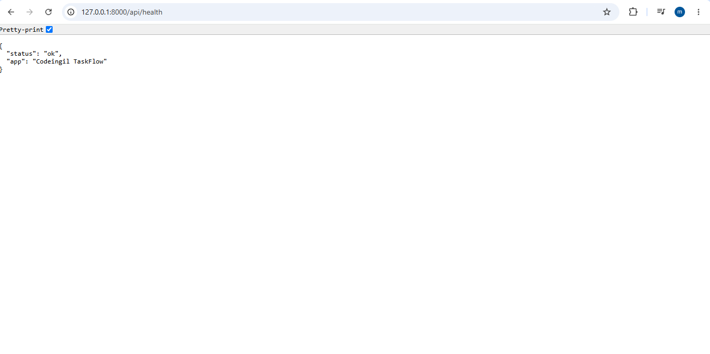


### React dashboard showing live API result
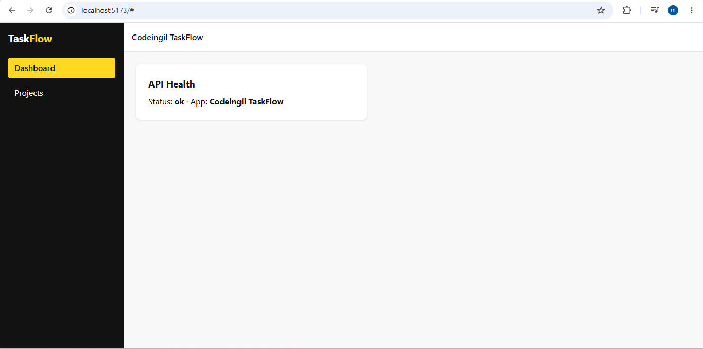

## Day 2 Evidence

### Projects page (data from MySQL)
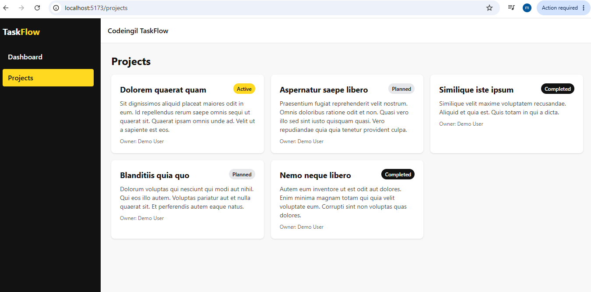

### Postman: list projects and 404
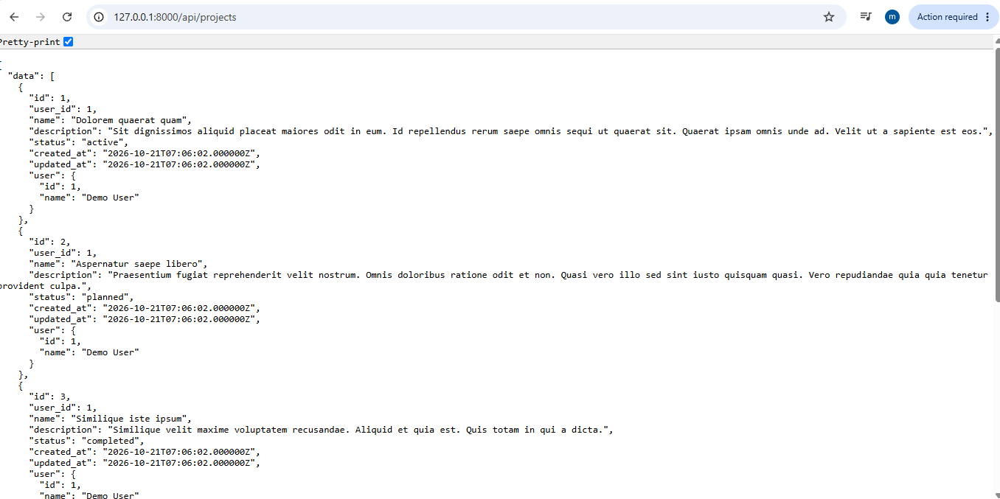
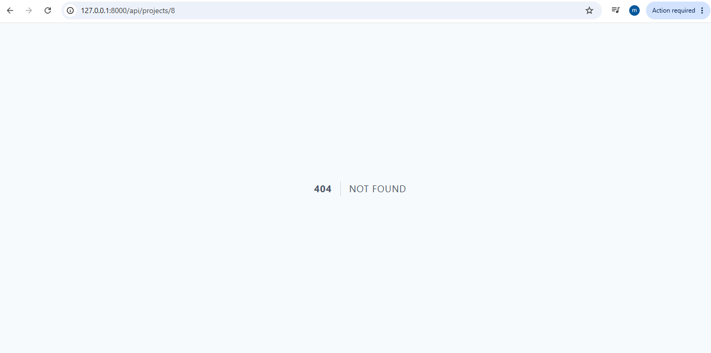

### Seeded rows in MySQL
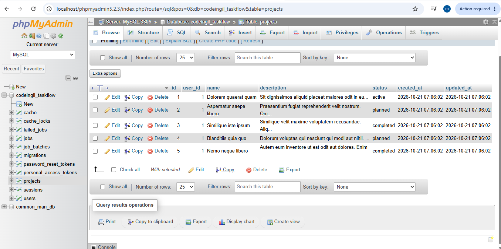

### Data flow

```
1. User opens /projects, React renders the Projects page
2. useEffect runs once and calls getProjects(), Axios sends GET /api/projects
3. Laravel matches the route in routes/api.php and calls ProjectController@index
4. Eloquent runs SELECT * FROM projects ORDER BY id (plus one query for owners)
5. MySQL returns rows, Laravel turns them into JSON {"data":[...]}
6. Axios receives the JSON, setProjects(res.data.data) updates state
7. React re-renders: projects.map() creates one ProjectCard per project
```

## Day 3 Evidence

### React Project creation Page
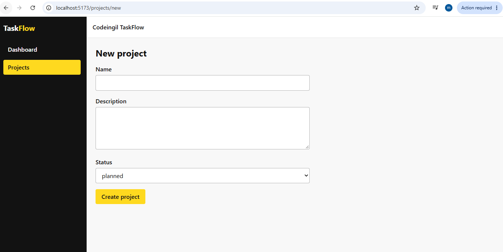

### Postman: create project
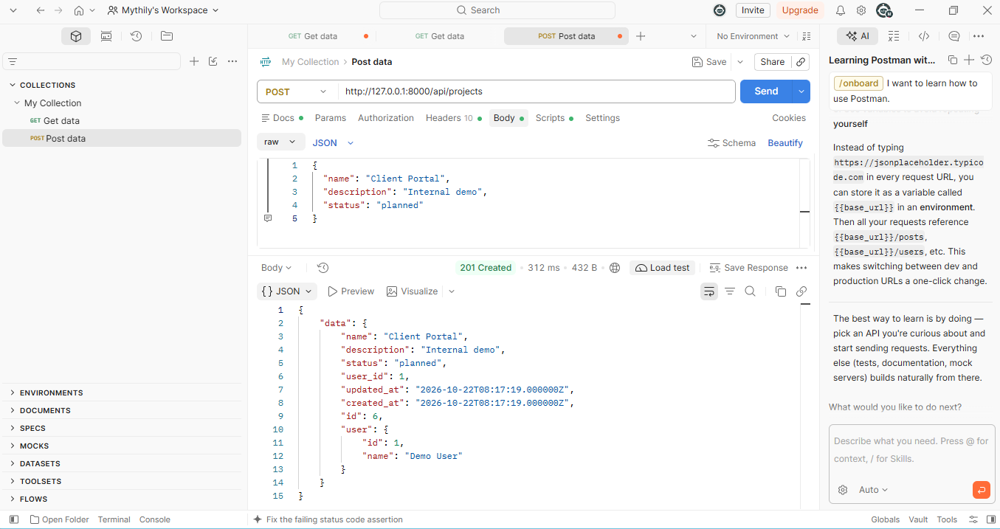

### Postman: validation error (422)
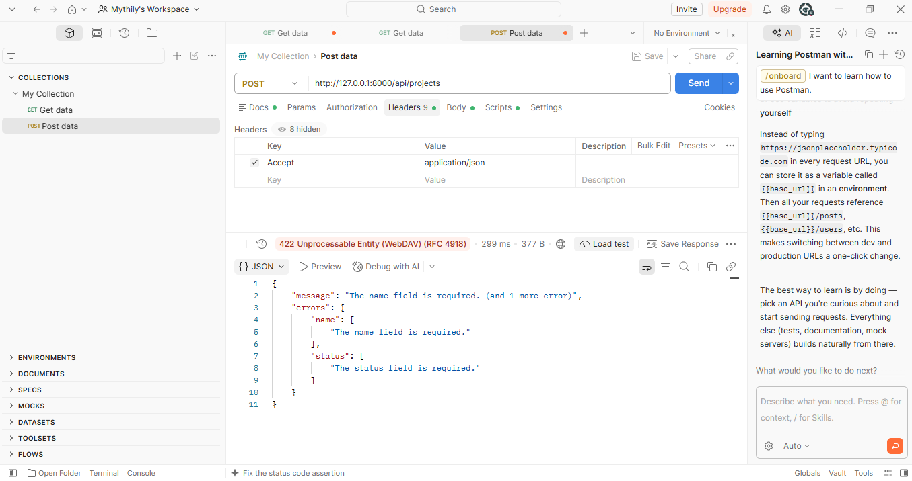

### Postman: update project
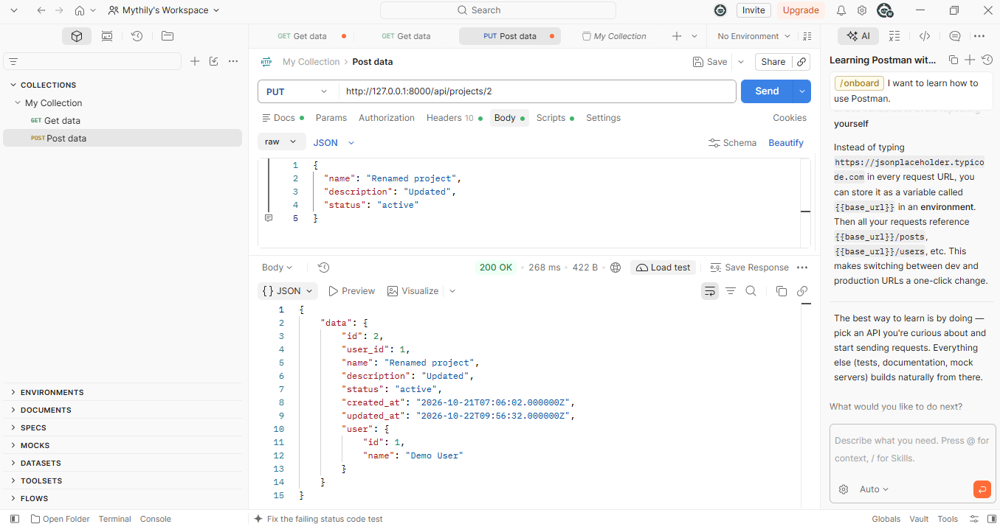


## Day 4 Evidence

### Delete confirmation
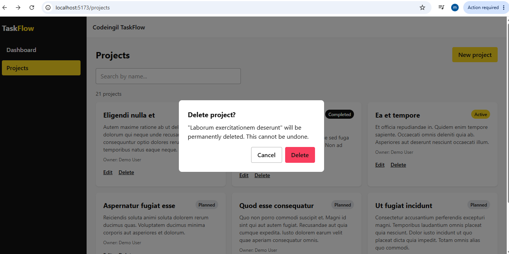

### Delete success message
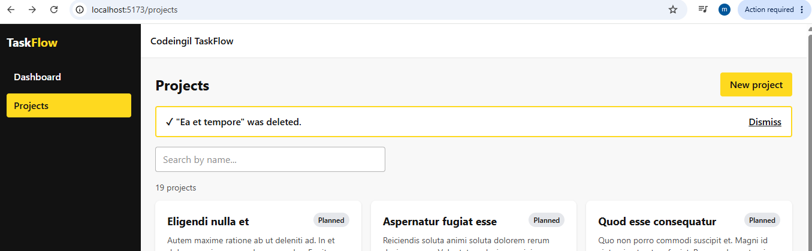

### Search
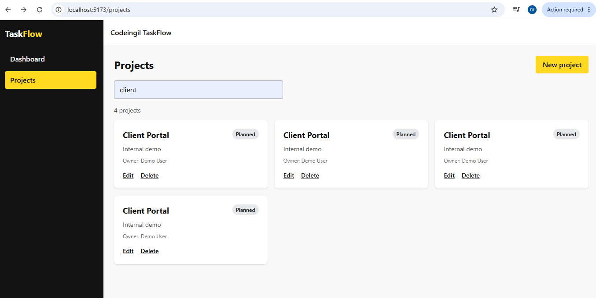

### Pagination
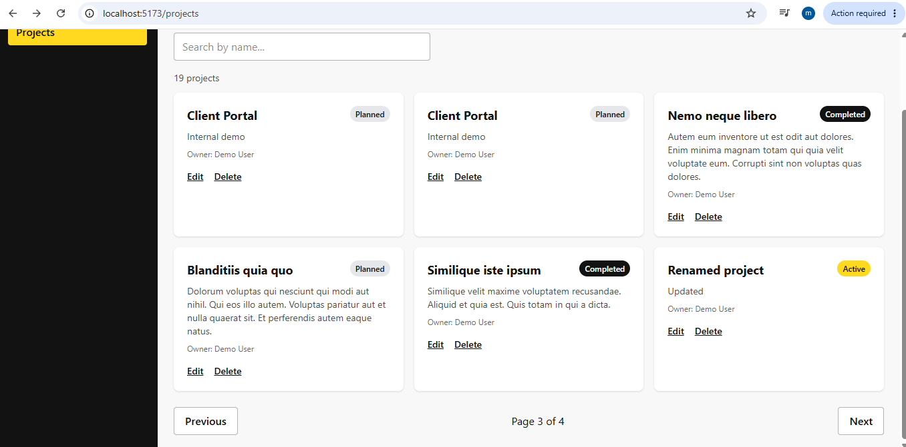

### Postman: 404 (missing record)
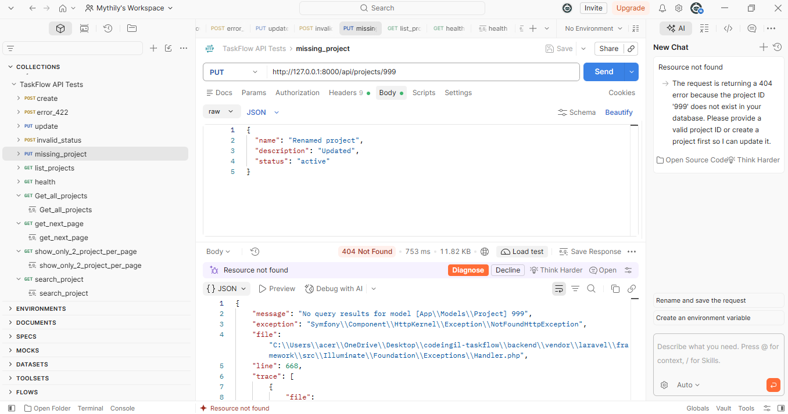

### Postman: 422 (invalid input)
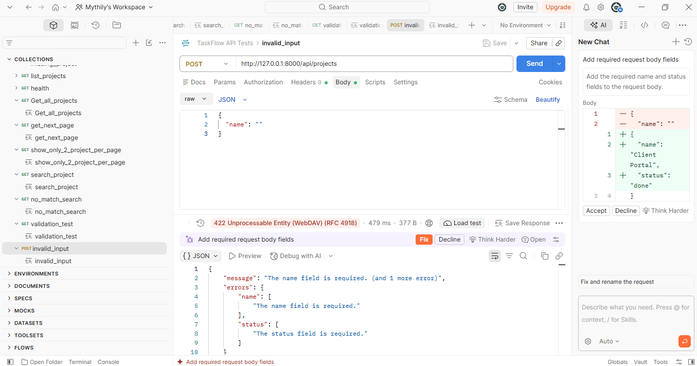

### Postman: 204 (successful delete)
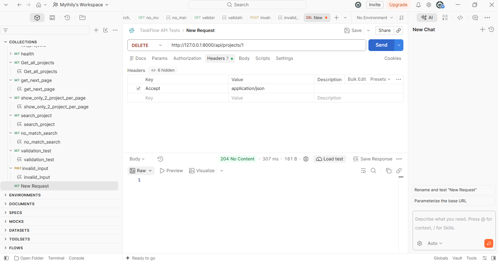


